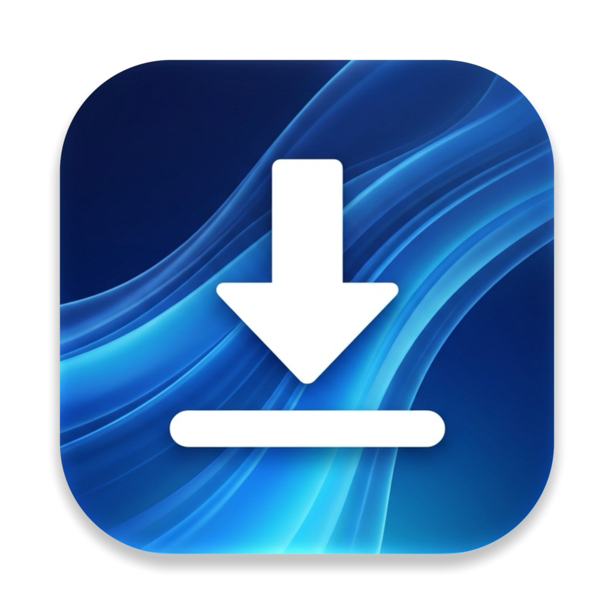

  

<h1 align="center">Lanes</h1>

  A fast, open download manager for macOS and Windows. 
  Many connections per file, resume after a stop, and one-click capture from the browser, in a Liquid&nbsp;Glass window.

  
  

  
  
  
  

Lanes is a download manager written in Rust. It opens many connections to a file at once, writes each range straight
into its place, and keeps a sidecar so a stopped download resumes instead of starting over. A browser extension hands
downloads to the app with the page's own headers, so a site that served the file to the browser serves it to Lanes
too, and puts a download button on the videos you watch, with a choice of resolution. The window is a single web page over a glass background; every rule behind it is tested Rust. It runs in the menu
bar, and is in English and Vietnamese.

## Features

- **Many connections per file.** Each file is split into equal ranges, up to 32 connections, each writing directly
  into the final file at its offset. No slow join step at the end. A connection that finishes its range takes over
  the second half of the largest one left, as IDM does, so a slow connection never holds up the end of the file.
- **Resume.** Progress is saved to a sidecar a few times a minute; after a crash, a power cut or a quit, the download
  carries on from where it stopped. The server is asked for the same file by its ETag, so a changed file restarts
  rather than mixing old and new bytes.
- **Browser capture.** The extension takes a download the browser started and sends it to Lanes with the Referer,
  Cookie and User-Agent of the page, which is what gets most "403 Forbidden" downloads through. Works in Chrome, Edge,
  Brave and Cốc Cốc; a right-click "Download with Lanes" is there too. If Lanes is not running, the extension starts
  it in the menu bar so the download begins at once.
- **Video button.** A round Lanes button sits in the top-right corner of a video while the pointer is over it, and
  for a few seconds when the video starts playing; it lists what Lanes can download for that video by resolution (4K,
  2K, 1080p, ...) with the size or an estimate. Whole video files go through the
  normal multi-connection engine; HLS streams (`.m3u8`) are fetched segment by segment in parallel, AES-128 included,
  resumable, and joined into one MP4 (an MPEG-TS stream rewrapped by ffmpeg, not encoded again). Video pages Lanes reads itself: YouTube (every resolution up to
  4K and the sound alone; a video for signed-in viewers, such as one behind an age check, with the browser's YouTube
  session), Facebook, Instagram, TikTok, Douyin and X, and on any other site the video the page names (Open Graph, JSON-LD,
  its `<video>` tags). The picked version comes in pieces over several connections and its picture and sound are
  joined into an MP4. Not supported: live streams, and anything with DRM, which Lanes never touches.
- **Progress in the browser.** What Lanes downloads shows in the browser too: the toolbar button carries the share
  done, a dock in the corner of the page in front fills a ring per download and turns it into a tick when it is done
  (with a button that shows the file in its folder), and the popup lists the latest downloads.
- **Nothing to install.** The ffmpeg that joins a picture to its sound comes inside Lanes: a 4 MB LGPL build of
  FFmpeg that only joins streams, made by `scripts/build-ffmpeg.sh` from the FFmpeg source. The script that YouTube's
  player runs on the addresses it gives a signed-in viewer runs in a QuickJS inside Lanes. yt-dlp is used only for a
  page Lanes cannot read, when it is installed (`brew install yt-dlp`, `winget install yt-dlp.yt-dlp`).
- **net-merge (beta): every network link at once.** With the switch in Settings on, the connections of a download are spread
  over every network link of the computer (Wi-Fi, Ethernet, a phone on USB with its hotspot on), as
  [net-merge](https://github.com/net-merge/net-merge) does, so one file comes at the speeds of all of them added up:
  plain files range by range, HLS segment by segment, video pages piece by piece, and yt-dlp pages eight pieces at a time. It needs no
  administrator: Lanes' own connections go through a proxy of Lanes on 127.0.0.1 that asks for a password made at
  random, and each leaves by the link it is given; nothing else on the computer changes. The first connection of a
  download to each site takes the system's usual link, another link serves a site only once the system's curl has
  reached that site over it with a certificate it accepts (a network whose firewall replaces the certificates of some
  sites is caught there), a link that fails a site keeps away from it for a while, and a link without internet gets
  nothing. YouTube signs its video addresses for one public address, so its pieces stay on one link. While a VPN
  carries all traffic nothing is merged. Settings lists the links with what each one carries.
- **net-merge (beta): several mirrors.** Paste several mirror URLs of one file and Lanes spreads the segments across
  them, merging their bandwidth. A mirror that disagrees on the size or allows no ranges is dropped, and each segment
  moves to the next mirror when one fails.
- **Pause, resume, speed and ETA** for every download, live.
- **Categories as in IDM.** Files go into `Compressed`, `Documents`, `Music`, `Programs` and `Video` inside the
  download folder by their extension (IDM's lists, plus dmg and pkg as programs); anything else stays in the folder
  itself. One switch in Settings turns it off.
- **A connection setting**, launch at login, and in-app updates.
- **Liquid Glass interface**, light and dark, that follows the system.

## Install

### macOS

An Apple silicon or Intel Mac with macOS 13 or later. With Homebrew:

    brew tap eliasbui/lanes
    brew install --cask eliasbui/lanes/lanes

Without Homebrew:

    curl -fsSL https://raw.githubusercontent.com/eliasbui/lanes/main/scripts/install.sh | sh

Writing the cask out in full installs it from the tap and trusts only that cask, so no `brew trust` is needed. The
app is signed ad hoc and not notarized, so both ways remove the quarantine flag after installing, as other open
source apps do. `brew uninstall --cask lanes` removes it, and `--zap` the download list in
`~/Library/Application Support/Lanes` too.

### Windows

In PowerShell:

    irm https://raw.githubusercontent.com/eliasbui/lanes/main/scripts/install.ps1 | iex

It installs for the current user into `%LOCALAPPDATA%\Programs\Lanes`, checks the download against the SHA-256 GitHub
publishes, and adds a Start-menu shortcut. Run the same line again to update; remove it from Settings, Apps.

### Browser extension

The app carries the extension and writes it to `~/Library/Application Support/Lanes/extension` (macOS) or
`%APPDATA%\Lanes\extension` (Windows) at every start; Settings, Browser extension shows the folder. Open
`chrome://extensions` (or the Edge, Brave, Cốc Cốc equivalent), turn on Developer mode and drag that folder onto the
page, or use "Load unpacked". The app refreshes the folder when it updates, and the extension reloads itself from it
as soon as the app answers with a newer version, so no browser restart is needed. Its id is fixed by the key in `extension/manifest.json`, so Lanes recognises it
wherever you load it from. The popup shows whether the extension reaches the app, and turns capture and the video
button on and off.

## Build and run

Rust 1.85 or later.

    cargo run

    cargo test                       # the engine, the store, the updater and the browser host
    cargo run --example make_icons   # redraw the icons in assets/
    scripts/bundle-macos.sh          # build dist/Lanes.app for this Mac

## How it works

- `src/engine.rs` — the download engine: probing for size and range support, planning equal segments, one connection
  per segment with positioned writes, a finished connection taking over half of the largest segment left, the resume
  sidecar, and retries.
- `src/netmerge.rs` — net-merge: the links of the computer, connections pinned to one (`IP_BOUND_IF` on macOS, the
  source address on Windows), the SOCKS5 proxy, the weights from the speeds seen, the probes and the checks of a link
  for a site. The same file is figghost's `crates/core-netmerge/src/lib.rs`.
- `src/hls.rs` — HLS playlists: resolutions of a master, segments, keys and byte ranges of a media playlist, and
  AES-128 decryption.
- `src/extract/` — video pages read by Lanes: a reader per site (YouTube, Facebook, Instagram, TikTok, Douyin, X, and one for
  any page) turns a page into its versions, each a file or a picture and a sound to join; `jsc.rs` solves YouTube's
  signature and `n` challenges in an embedded QuickJS. The engine fetches them in pieces of at most 10 MiB, the most
  googlevideo serves at full speed in one request.
- `src/ytdlp.rs` — video pages through yt-dlp, for a page no reader knows: the formats as menu choices, and the
  download with its progress.
- `src/store.rs` — the list of downloads in SQLite.
- `src/browser.rs` — the native-messaging host, the inbox the extension drops jobs into, and the extension the app
  carries.
- `src/update.rs` — the in-app update: read the latest release, verify its SHA-256, swap the app in place, restart.
- `src/autostart.rs` — launch at login (a LaunchAgent on macOS, the Run key on Windows).
- `src/main.rs` — the window, the tray and the glue between the page and the engine.
- `ui/index.html` — the whole interface, one file.

## Data and privacy

The download list and settings live in `~/Library/Application Support/Lanes` (macOS) or `%APPDATA%\Lanes` (Windows).
Lanes talks to the servers you download from and to GitHub for the update check; the browser extension sends a job
only to the local app, never over the network. To read a video page, Lanes asks that site with the cookies your
browser sends it (on YouTube only for a video for signed-in viewers), and sends them nowhere else. With net-merge on, and only while a download runs, Lanes now and then
opens a TCP connection to 1.1.1.1 and 8.8.8.8 on port 443 over each link, sending nothing, to know which links reach
the internet, and runs the system's curl once per site and link to ask that site for its headers over it.

## Licence

MIT. See [LICENSE](LICENSE). Lanes is an original program; it is not affiliated with any other download manager.

`src/netmerge.rs` is the scheduler of [net-merge](https://github.com/net-merge/net-merge) written again in Rust,
copyright 2026 Rohit Mahto, under the MIT License: see [NET-MERGE-LICENSE.txt](NET-MERGE-LICENSE.txt).

`src/extract/ejs/` is the challenge solver of [yt-dlp's EJS project](https://github.com/yt-dlp/ejs), released into
the public domain (Unlicense, see [src/extract/ejs/LICENSE](src/extract/ejs/LICENSE)); it bundles meriyah (ISC) and
astring (MIT), whose notices head `lib.min.js`. The site readers in `src/extract/` follow the logic of yt-dlp's
extractors, which are public domain too.
